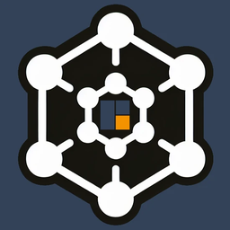

# 🛡️ Ketesa



**Ketesa** (formerly **Synapse Admin**) is a fully featured, mobile-friendly admin interface for
Matrix homeservers powered by **Synapse**. Manage users, rooms, media, event & user reports,
registration tokens and devices — with first-class support for the **Matrix Authentication
Service (MAS)**.

It is a direct drop-in replacement for Synapse Admin: no configuration changes required.
Ketesa is a static web app — it runs entirely in your browser and talks directly to your
homeserver's admin API.

🏷️ **Category:** Hosting, Network, System

🐳 **Image:** `ghcr.io/etkecc/ketesa:latest`

---

## 🔗 Links

| | |
|---|---|
| 🌐 **Website** | [ketesa.app](https://ketesa.app) |
| 📦 **Project** | [github.com/etkecc/ketesa](https://github.com/etkecc/ketesa) |
| 📖 **Documentation** | [Ketesa Docs](https://github.com/etkecc/ketesa/tree/main/docs) |
| 🐛 **Support** | [GitHub Issues](https://github.com/etkecc/ketesa/issues) |
| 💬 **Matrix Room** | [#ketesa:etke.cc](https://matrix.to/#/#ketesa:etke.cc) |
| 💛 **Donate** | [GitHub Sponsors](https://github.com/sponsors/etkecc) |

---

## 🌐 Ports

| Port | Protocol | Description |
|---|---|---|
| `8076` | TCP | Ketesa web interface (container port `8080`) |

> ℹ️ Since the image is rootless, it listens on port **8080** inside the container (not 80).
> The host port defaults to `8076` in this template to avoid the common `8080` conflict.

---

## 💾 Volumes

| Host Path | Container Path | Mode | Description |
|---|---|---|---|
| `/mnt/cache/appdata/ketesa/config.json` | `/var/public/config.json` | RO | Optional Ketesa configuration file |

> ⚠️ **Important:** This is a **file** mount. Create the file **before** the first start —
> otherwise Docker creates a directory at that path and Ketesa cannot read its config.

---

## ⚙️ Environment Variables

No environment variables required for this container.

---

## 📄 Configuration File

Ketesa runs **without any configuration** — every option is optional. To start with an empty
config, create the file with this content:

```json
{}
```

Settings can come from two places: this `config.json`, or the `cc.etke.ketesa` key inside your
homeserver's `/.well-known/matrix/client`. If a key is set in both, the **well-known value wins**.

### Available options

| Option | Type | Default | Description |
|---|---|---|---|
| `restrictBaseUrl` | string or array | unrestricted | Lock Ketesa to specific homeserver(s) |
| `externalAuthProvider` | boolean | off | Declare that an external auth provider (OIDC, LDAP, …) is in use |
| `wellKnownDiscovery` | boolean | `true` | Canonicalize URLs via `/.well-known/matrix/client` — turn off for split-domain or VPN-only setups |
| `corsCredentials` | `same-origin` / `include` / `omit` | `same-origin` | How cookies are sent on admin API requests |
| `asManagedUsers` | array of MXID regex | none | Protect bridge/bot accounts from accidental edits |
| `menu` | array of menu items | none | Add custom links to the sidebar |

### Example: lock Ketesa to your own homeserver

```json
{
  "restrictBaseUrl": "https://matrix.yourdomain.com"
}
```

With a single URL the homeserver field disappears from the login page. A list turns it into a
dropdown limited to those servers.

---

## 🚀 Quick Start

1. Create the config file at `/mnt/cache/appdata/ketesa/config.json` (content `{}` is enough)
2. Open the **MOS Hub** and search for **Ketesa**
3. Click **Install**
4. Access Ketesa at `http://your-server-ip:8076`
5. Enter your homeserver URL and log in with a **Synapse admin account**

---

## 📋 Requirements

- **Synapse v1.150.0 or newer** for everything to work as intended
  (check via `/_synapse/admin/v1/server_version` or the version indicator on the login page)
- Your **browser** must be able to reach these endpoints on your homeserver:
  - `/_matrix`
  - `/_synapse/admin`

> 💡 The admin endpoints do **not** need to be exposed to the public internet — access from your
> local network is enough. See the
> [Synapse administration endpoints](https://element-hq.github.io/synapse/latest/reverse_proxy.html#synapse-administration-endpoints) docs.

> ℹ️ Using **MAS**? Its admin API needs some extra configuration — see the
> [MAS section](https://github.com/etkecc/ketesa/blob/main/docs/external-auth-provider.md#matrix-authentication-service-mas) in the Ketesa docs.

---

## 💡 Tips

- **Reverse proxy:** Running Ketesa behind a reverse proxy with SSL is the recommended setup for
  any internet-facing deployment. Ready-to-use configs are in the
  [reverse proxy guide](https://github.com/etkecc/ketesa/blob/main/docs/reverse-proxy.md).
- **Subpath deployment:** To serve Ketesa under `/admin` (e.g. `https://example.com/admin`), use
  the tag `latest-subpath-admin` instead of `latest`.
- **Coming from Synapse Admin?** The legacy `cc.etke.synapse-admin` well-known key still works as
  a fallback, so existing setups need no changes.
- **Docker Hub mirror:** The image is also available as `etkecc/ketesa:latest`.

> ⚠️ **Note:** Ketesa requires a running **Synapse** homeserver to connect to. Pair it with the
> **Element Web** template for a complete self-hosted Matrix setup.

> 📚 **For more information:** Visit [ketesa.app](https://ketesa.app) and the
> [Ketesa documentation](https://github.com/etkecc/ketesa/tree/main/docs).
