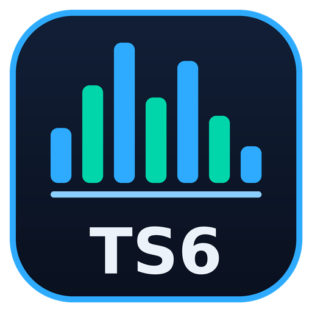

# 🎛️ TS6 Manager



**TS6 Manager** is a web-based management interface for TeamSpeak servers. It lets you
control virtual servers, channels, clients, permissions, music bots, automated workflows
and embeddable server widgets — all from your browser.

It is built on the **WebQuery HTTP API**, the ServerQuery replacement in modern TeamSpeak
builds. Telnet is not used or supported. It pairs naturally with the
[🎙️ TeamSpeak 6 Server](Teamspeak6.html) template.

🏷️ **Category:** Game Server

🐳 **Images:**

| Template | Image |
|---|---|
| `TS6-Manager-Backend` | `clusterzx/ts6-manager:backend` |
| `TS6-Manager-Frontend` | `clusterzx/ts6-manager:frontend` |
| `TS6-Manager-Sidecar` | `clusterzx/ts6-manager:sidecar` |

---

## 🖼️ Screenshots


<sub>Screenshots: [clusterzx/ts6-manager](https://github.com/clusterzx/ts6-manager) (MIT)</sub>

---

## ✨ Features

| Area | What you get |
|---|---|
| 🖥️ **Server Management** | Live dashboard, channel tree with drag & drop, client actions (kick, ban, move, poke), server & channel groups, permission editor, ban list, privilege keys, logs, file browser |
| 🎵 **Music Bots** | Multiple bots per server with own queue, radio streams, YouTube via yt-dlp, local music library, in-channel chat commands |
| 📺 **Video Streaming** | Live video from YouTube, Twitch or direct URLs into TeamSpeak channels via the WebRTC sidecar |
| 🔀 **Bot Flow Engine** | Visual node editor — triggers (TS events, cron, webhooks, chat commands), conditions and actions; templates for temp channels, AFK mover, idle kicker and more |
| 🪧 **Server Widgets** | Embeddable status banner for websites as live page, SVG or PNG |
| 🔒 **Security** | Setup wizard (no default credentials), AES-256-GCM encrypted credentials, admin / viewer roles, per-server access |

---

## 🧩 Stack Overview

TS6 Manager consists of **three containers**. Each one is its own template in the MOS Hub.

| Template | Role | Required |
|---|---|---|
| `TS6-Manager-Backend` | Express API, WebQuery client, bot engine, music bots, SQLite database | ✅ |
| `TS6-Manager-Frontend` | React web UI served by nginx, proxies `/api` and `/ws` to the backend | ✅ |
| `TS6-Manager-Sidecar` | Go/Pion WebRTC relay for video streaming | Only for video streaming |

```
Browser ──▶ Frontend :3000 ──▶ backend:3001 ──▶ TeamSpeak WebQuery :10080
                                    │                     SSH Query :10022
                                    └──▶ ts6-sidecar:9800 (video)
```

### 🔌 How the containers find each other

The upstream images expect the hostnames `backend` and `ts6-sidecar`
(the frontend's nginx config proxies to `http://backend:3001`, the backend defaults to
`SIDECAR_URL=http://ts6-sidecar:9800`).

The templates solve this with Docker's `--add-host` option in **Extra Parameters**:

| Template | Extra Parameter | Effect |
|---|---|---|
| Frontend | `--add-host=backend:host-gateway` | `backend` resolves to the MOS host → host port `3001` |
| Backend | `--add-host=ts6-sidecar:host-gateway` | `ts6-sidecar` resolves to the MOS host → host port `9800` |

> ⚠️ **Important:** Because of this, the backend **must** be published on host port
> `3001` and the sidecar on host port `9800`. Only the frontend port (`3000`) can be
> changed freely.

---

## 🔗 Links

| | |
|---|---|
| 📦 **Project** | [github.com/clusterzx/ts6-manager](https://github.com/clusterzx/ts6-manager) |
| 🐛 **Support** | [GitHub Issues](https://github.com/clusterzx/ts6-manager/issues) |
| 💬 **Community** | [TeamSpeak Community – TS6 Server Tools](https://community.teamspeak.com/c/teamspeak-6-server/tools/49) |

---

## 🌐 Ports

| Template | Port | Protocol | Description |
|---|---|---|---|
| Frontend | `3000` → `80` | TCP | Web interface (nginx) |
| Backend | `3001` | TCP | API & WebSocket — must stay `3001` |
| Sidecar | `9800` | TCP | Sidecar HTTP control API — must stay `9800` |

> ⚠️ **Port conflicts:** In this repository, **Grafana**, **Homepage**, **Tracearr** and
> **Gotenberg** also default to host port `3000`, **Uptime Kuma** and **Dashdot** to `3001`.
> Change the frontend port to a free one if needed. If `3001` is taken, move the other
> app to a different host port — or use the custom nginx config described under
> **Advanced: Custom Backend Port** below.

---

## 💾 Volumes

| Template | Host Path | Container Path | Mode | Description |
|---|---|---|---|---|
| Backend | `/mnt/cache/appdata/ts6-manager/data` | `/app/packages/backend/data` | RW | SQLite database & uploaded YouTube cookie file |
| Backend | `/mnt/cache/appdata/ts6-manager/music` | `/data/music` | RW | Music library & yt-dlp downloads |

Frontend and sidecar store no data.

---

## ⚙️ Environment Variables

### 🔙 Backend

| Variable | Default | Masked | Description |
|---|---|---|---|
| `JWT_SECRET` | *(empty)* | ✅ | **Required.** Random secret, min. 32 characters. Without it the backend exits on start |
| `ENCRYPTION_KEY` | *(empty)* | ✅ | Recommended. Key for encrypting stored API keys & SSH passwords. Falls back to `JWT_SECRET` |
| `FRONTEND_URL` | `http://YOUR-SERVER-IP:3000` | ❌ | URL of the web UI, used as CORS origin |
| `TS_ALLOW_SELF_SIGNED` | `false` | ❌ | `true` if WebQuery runs over HTTPS with a self-signed certificate |
| `SIDECAR_URL` | `http://ts6-sidecar:9800` | ❌ | Sidecar address — works with the `--add-host` entry |
| `DATABASE_URL` | `file:/app/packages/backend/data/ts6webui.db` | ❌ | SQLite path inside the container — leave as is |
| `MUSIC_DIR` | `/data/music` | ❌ | Music path inside the container — leave as is |
| `NODE_ENV` | `production` | ❌ | Runtime mode — leave as is |
| `PORT` | `3001` | ❌ | Internal API port — must stay `3001` |
| `JWT_ACCESS_EXPIRY` | `15m` | ❌ | Access token lifetime |
| `JWT_REFRESH_EXPIRY` | `7d` | ❌ | Refresh token lifetime |
| `TZ` | `Europe/Vienna` | ❌ | Container timezone |

### 📺 Sidecar

| Variable | Default | Masked | Description |
|---|---|---|---|
| `SIDECAR_PORT` | `9800` | ❌ | Internal HTTP port — must match `SIDECAR_URL` |
| `SIDECAR_DEBUG_LOGS` | `0` | ❌ | `1` enables verbose debug logging |

### 🖥️ Frontend

No environment variables required for this container.

---

## 🚀 Quick Start

  ├─ 1️⃣ Generate the secrets

     ```bash
     openssl rand -base64 32   # → JWT_SECRET
     openssl rand -base64 32   # → ENCRYPTION_KEY
     ```

  ├─ 2️⃣ Create the data directories

     ```bash
     mkdir -p /mnt/cache/appdata/ts6-manager/data
     mkdir -p /mnt/cache/appdata/ts6-manager/music
     ```

  ├─ 3️⃣ Install from the MOS Hub — in this order

     1. **TS6-Manager-Sidecar**
     2. **TS6-Manager-Backend** — paste `JWT_SECRET` and `ENCRYPTION_KEY`,
        replace `YOUR-SERVER-IP` in `FRONTEND_URL`
     3. **TS6-Manager-Frontend**

  ├─ 4️⃣ Create the admin account

     Open `http://your-server-ip:3000/setup` and create your admin user.
     There are no default credentials.

  ├─ 5️⃣ Prepare your TeamSpeak server

     - **WebQuery HTTP** must be enabled (the TeamSpeak 6 template exposes it on `10080`)
     - Create a **WebQuery API key** — e.g. with the `apikeyadd` query command
     - **SSH Query** (`10022`) plus username & password are only needed for
       bot flow event triggers

  └─ 6️⃣ Connect the server

     In TS6 Manager go to **Settings → Connections** and add:

     | Field | Value |
     |---|---|
     | Host | IP of your MOS server |
     | WebQuery Port | `10080` |
     | API Key | your WebQuery API key |
     | SSH Port | `10022` *(optional)* |

> ⚠️ **Note:** Do **not** use `localhost` or `127.0.0.1` as host — inside the backend
> container that points to the container itself, not to your TeamSpeak server.

---

## 🎵 Music Bot Commands

Users in the bot's channel can control it via text chat:

| Command | Description |
|---|---|
| `!radio` | List available radio stations |
| `!radio <id>` | Play a radio station |
| `!play <url>` | Play from YouTube URL |
| `!play` | Resume paused playback |
| `!stop` | Stop playback |
| `!pause` | Toggle pause / resume |
| `!skip` / `!next` | Next track in queue |
| `!prev` | Previous track |
| `!vol` | Show current volume |
| `!vol <0-100>` | Set volume |
| `!np` | Show current track |

---

## 🩺 Troubleshooting

  ├─ **Backend stops right after start**

     The log shows `[FATAL] JWT_SECRET is set to the default value`.
     → `JWT_SECRET` is empty. Set it and restart the container.

  ├─ **Frontend container keeps restarting**

     nginx can't resolve `backend`.
     → Check that **Extra Parameters** of the frontend contain
     `--add-host=backend:host-gateway`.

  ├─ **Web UI loads, but login / API calls fail (502)**

     → Make sure `TS6-Manager-Backend` is running and published on host port `3001`.

  ├─ **Video streaming doesn't start**

     → Check that `TS6-Manager-Sidecar` is running on host port `9800` and that the
     backend has `--add-host=ts6-sidecar:host-gateway` in its Extra Parameters.

  └─ **YouTube asks for a bot check / age-restricted videos fail**

     → Upload a Netscape-format `cookies.txt` under **Settings → YouTube** in the UI.
     It is stored in the data volume and survives restarts.

---

## 🛠️ Advanced: Custom Backend Port

If host port `3001` is already taken, you can override the frontend's nginx config
so it proxies to another port.

  ├─ 1️⃣ Change the backend's **host** port (e.g. `3011`) — keep the container port `3001`

  ├─ 2️⃣ Create `/mnt/cache/appdata/ts6-manager/nginx/default.conf`
  
     ```nginx
     server {
         listen 80;
         server_name _;
         root /usr/share/nginx/html;
         index index.html;

         client_max_body_size 150m;

         location /api {
             proxy_pass http://backend:3011;
             proxy_http_version 1.1;
             proxy_set_header Upgrade $http_upgrade;
             proxy_set_header Connection "upgrade";
             proxy_set_header Host $host;
             proxy_set_header X-Real-IP $remote_addr;
             proxy_set_header X-Forwarded-For $proxy_add_x_forwarded_for;
             proxy_set_header X-Forwarded-Proto $scheme;
         }

         location /ws {
             proxy_pass http://backend:3011;
             proxy_http_version 1.1;
             proxy_set_header Upgrade $http_upgrade;
             proxy_set_header Connection "upgrade";
             proxy_set_header Host $host;
         }

         location /widget/ {
             add_header X-Frame-Options "";
             add_header Content-Security-Policy "frame-ancestors *";
             try_files $uri $uri/ /index.html;
         }

         location / {
             try_files $uri $uri/ /index.html;
         }

         gzip on;
         gzip_types text/plain text/css application/json application/javascript text/xml;
     }
     ```

  └─ 3️⃣ Add a path to the frontend template

     | Host Path | Container Path | Mode |
     |---|---|---|
     | `/mnt/cache/appdata/ts6-manager/nginx/default.conf` | `/etc/nginx/conf.d/default.conf` | RO |

> 💡 **Tip:** This is the image's built-in config with only the two `proxy_pass` ports changed.

---

## 💡 Notes

> 🔒 **Security:** Only the frontend (`3000`) needs to be reachable for users.
> Keep `3001` and `9800` closed to the internet — the backend API is meant to be
> accessed through the frontend.

> 🔑 **Encryption key:** Stored API keys and SSH passwords are encrypted with a key
> derived from `ENCRYPTION_KEY` (or `JWT_SECRET` if empty). If you change it later,
> existing credentials can no longer be decrypted and have to be re-entered.

> 🌍 **Reverse proxy:** Point your proxy (e.g. SWAG, Nginx Proxy Manager) at the
> frontend port and set `FRONTEND_URL` to your public URL. WebSockets (`/ws`) must be
> allowed through.

> 🪧 **Widgets:** Public server widgets under `/widget/<token>` work without login and
> can be embedded in websites.

> 🤖 **AI notice:** The upstream project marks itself as an *AI Assisted Project*.

> 📚 **For more information:** See the
> [TS6 Manager README](https://github.com/clusterzx/ts6-manager#readme) for all features
> and the full list of sidecar tuning variables.
